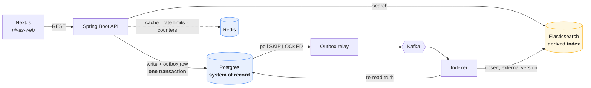

# Nivas

A property search platform, built backend-first.

Postgres is the system of record. Elasticsearch serves search and is kept in step
through a **transactional outbox**, so it can always be rebuilt from the database.
Redis handles caching, distributed rate limiting and view counting.



Sequence diagrams for the write and read paths are in
[`docs/architecture.md`](docs/architecture.md).

## Why it is built this way

**The listing write and the search update cannot be allowed to disagree.**
Writing to Postgres and then to Elasticsearch is a dual write: if the second call
fails, a listing exists but is unfindable, and nothing ever notices. Instead every
listing change writes an `outbox_events` row *in the same transaction*. A relay
polls that table with `FOR UPDATE SKIP LOCKED` — so it is safe to run on every
node — and publishes to Kafka. The indexer consumes, re-reads current state from
Postgres, and writes to Elasticsearch with an **external version** taken from the
row's optimistic-lock version. A redelivered or out-of-order event is therefore
rejected by the index rather than reinstating stale data.

**Search quality lives in the mapping, not in the query.** The index is authored
as JSON — edge-ngram autocomplete with a separate search analyzer, search-time
synonym graphs, a completion suggester with a city context, `scaled_float` prices,
a `geo_point`. It is `dynamic: strict`, so a field the mapping does not know about
fails the write instead of being silently indexed with a guessed type.

**Filters never touch the score.** Only free text goes in the `must` clause;
price, bedrooms, city and geo all go in `filter`, where they are unscored and
cacheable. An exact price match is not "more relevant".

**Reads do not become writes.** A detail-page view is the highest-frequency
operation in the product. Incrementing a counter column per view would put a row
lock on the most popular listings. Views accumulate in Redis and a scheduled job
folds them back in batches.

**Alerts remember what they already said.** A saved search stores the search
request verbatim as `jsonb`, so replaying it runs the exact query the user built.
Each carries a watermark — the instant it last notified — and the next run asks
only for listings published after it. Without that, every tick re-sends the same
listings, which is how a product gets marked as spam.

## Running it

Requires JDK 21 and Docker.

```bash
source scripts/env.sh                              # puts JDK 21 on PATH
docker compose -f infra/docker-compose.yml up -d   # postgres, redis, elasticsearch, kafka
cd nivas-api && ./mvnw spring-boot:run
```

Add observability, or Kibana:

```bash
docker compose -f infra/docker-compose.yml --profile observability up -d
```

| What | Where |
| --- | --- |
| API | http://localhost:8080 |
| Swagger UI | http://localhost:8080/swagger-ui.html |
| Health | http://localhost:8080/actuator/health |
| Metrics | http://localhost:8080/actuator/prometheus |
| Kibana (`--profile tools`) | http://localhost:5601 |
| Prometheus (`--profile observability`) | http://localhost:9090 |
| Grafana (`--profile observability`) | http://localhost:3001 |

Flyway creates the schema and seeds ~33 localities across eight cities on first
start, so filters and facets have something to work with immediately.

Then load some listings:

```bash
python3 scripts/seed-demo.py
```

It talks to the public API rather than writing to Postgres directly — a direct
`INSERT` would produce listings that were never published through the state
machine, so no outbox event is written and nothing reaches the index. Going
through the API means it doubles as an end-to-end smoke test: it polls search
until the index catches up, and tells you which hop is stuck if it does not.

It prints demo credentials when it finishes.

## Testing

```bash
./mvnw test      # unit tests — fast, no Docker needed
./mvnw verify    # adds integration tests against real containers
```

Unit tests cover the listing state machine, aggregate invariants, JWT handling,
and — usefully — the generated Elasticsearch query, by serialising it to JSON and
asserting on the DSL. That catches the search bugs that actually happen (a filter
drifting into the scoring clause, amenities becoming OR instead of AND) in
milliseconds rather than behind a container boot. A further test reflects over
`PropertyDocument` and checks every field exists in the hand-written mapping,
which is what keeps `dynamic: strict` from turning a rename into a runtime failure.

Integration tests use Testcontainers and exercise the real seams: the full
write → outbox → Kafka → index → search pipeline, refresh-token rotation, and the
Lua rate limiter under genuine concurrency.

They **skip** rather than fail when no Docker daemon is reachable, so `./mvnw test`
still works anywhere. That convenience has a sharp edge: a skipped suite still
reports `BUILD SUCCESS`. Set `NIVAS_REQUIRE_DOCKER=true` — as CI does — to turn a
missing daemon into a failure instead, so a misconfigured runner cannot go green
while testing nothing.

> **OrbStack / Colima users:** Testcontainers looks for `/var/run/docker.sock`,
> which neither creates. Without this the whole suite silently skips:
>
> ```bash
> export DOCKER_HOST="unix://$HOME/.orbstack/run/docker.sock"
> export TESTCONTAINERS_DOCKER_SOCKET_OVERRIDE=/var/run/docker.sock
> ```
>
> `scripts/env.sh` exports both if it detects OrbStack.

## Load testing

Measured on an M-series MacBook with the whole stack — Postgres, Redis,
Elasticsearch, Kafka and the API — running on the same machine, 36 listings
indexed. 50 virtual users, 12,093 requests over 4 minutes, **0 failures**.

| Endpoint | median | p95 | p99 | max |
| --- | --- | --- | --- | --- |
| Listing detail (cache-aside) | 2.5 ms | 7.2 ms | 18.9 ms | 45.7 ms |
| Geo radius + distance sort | 8.1 ms | 19.6 ms | 30.3 ms | 46.9 ms |
| Faceted search (6 aggregations) | 12.1 ms | 27.1 ms | 37.7 ms | 66.8 ms |
| Plain text search | 13.0 ms | 29.8 ms | 43.2 ms | 78.2 ms |

Two things worth reading off that table. Detail is roughly 4x faster than search
because it is usually served from Redis rather than Elasticsearch. And plain text
search is *slower* than faceted search — the filters narrow the candidate set
before scoring, while an unfiltered fuzzy `multi_match` plus `function_score` has
to score everything.

A caveat on the numbers: 36 listings fit comfortably in one shard and in page
cache, so these measure query construction and round trips, not retrieval at
scale. Treat them as a floor.

```bash
brew install k6
k6 run scripts/load-test.js                 # ramp to 50 VUs
PROFILE=stress k6 run scripts/load-test.js  # ramp to 300
```

Each virtual user presents a distinct `X-Forwarded-For`, as a real proxy would.
Without that, every VU shares one rate-limit bucket and roughly three quarters of
requests come back 429 — which costs a Redis call and never reaches
Elasticsearch, so the run reports a flattering p95 while measuring almost
nothing. The first version of this script did exactly that.

Seed first — against an empty index every query returns nothing and the numbers
mean nothing.

The script separates plain search, faceted search, geo search and listing detail
into their own metrics rather than reporting one aggregate. They have genuinely
different cost profiles: a faceted query runs six aggregations, while detail is
usually served from Redis. A single p95 across both would hide which one is slow.
Under the stress profile the rate limiter starts returning 429s — that is the
system working, so those are excluded from the failure rate.

## API

| Method | Path | Notes |
| --- | --- | --- |
| `POST` | `/api/v1/auth/register` | Returns an access + refresh pair |
| `POST` | `/api/v1/auth/login` | Constant-time against unknown emails |
| `POST` | `/api/v1/auth/refresh` | Rotates the refresh token |
| `POST` | `/api/v1/auth/logout-all` | Revokes every session |
| `GET` | `/api/v1/search` | Filters, facets, geo, sorting |
| `GET` | `/api/v1/properties/{id}` | Cached; records a de-duplicated view |
| `POST` | `/api/v1/properties` | Creates a draft |
| `PATCH` | `/api/v1/properties/{id}/status` | Publish / sold / rented |
| `POST` | `/api/v1/properties/{id}/leads` | Anonymous, rate limited, idempotent |
| `GET` | `/api/v1/leads` | The owner's enquiry inbox |
| `GET` | `/api/v1/saved-searches` | Stored filters, each with a new-match count |
| `POST` | `/api/v1/saved-searches` | Saves criteria; optional alerting |
| `POST` | `/api/v1/admin/index/rebuild` | Rebuilds the index from Postgres |

A search combining most of it:

```bash
curl -G http://localhost:8080/api/v1/search \
  --data-urlencode "q=2 bhk koramangala" \
  --data-urlencode "listingType=RENT" \
  --data-urlencode "minPrice=20000" \
  --data-urlencode "maxPrice=60000" \
  --data-urlencode "bedrooms=2" \
  --data-urlencode "amenities=PARKING" \
  --data-urlencode "amenities=LIFT" \
  --data-urlencode "lat=12.9352" \
  --data-urlencode "lon=77.6245" \
  --data-urlencode "radiusKm=5" \
  --data-urlencode "sort=DISTANCE"
```

Returns results, per-dimension facet counts and price statistics in one round trip.

## Layout

```
nivas/
├── nivas-api/          Spring Boot 4 service
│   └── src/main/java/com/nivas/
│       ├── auth/       registration, JWT, refresh-token rotation
│       ├── catalog/    the Property aggregate and its write side
│       ├── search/     query construction, facets, geo
│       ├── indexing/   document projection and the Kafka consumer
│       ├── outbox/     transactional outbox and relay
│       ├── lead/       enquiries
│       ├── analytics/  Redis view counters
│       └── common/     errors, pagination, rate limiting
├── infra/              docker-compose, Prometheus, Grafana
├── docs/adr/           the decisions, and what they cost
└── scripts/
```

## Stack

Java 21 (virtual threads) · Spring Boot 4.1 · Spring Security 7 · Postgres 17 ·
Elasticsearch 9 · Redis 7 · Kafka (KRaft) · Flyway · Testcontainers ·
Micrometer + Prometheus + Grafana · springdoc OpenAPI

## Decisions

Each of these is written up in [`docs/adr/`](docs/adr/), including what it costs:

1. [Postgres as the system of record, Elasticsearch as a derived index](docs/adr/0001-postgres-as-source-of-truth.md)
2. [Transactional outbox instead of dual writes](docs/adr/0002-transactional-outbox.md)
3. [Stateless access tokens, stateful refresh tokens](docs/adr/0003-jwt-and-refresh-tokens.md)
4. [Redis for caching, rate limiting and counters](docs/adr/0004-redis-usage.md)
5. [Search relevance and the index mapping](docs/adr/0005-search-relevance.md)
