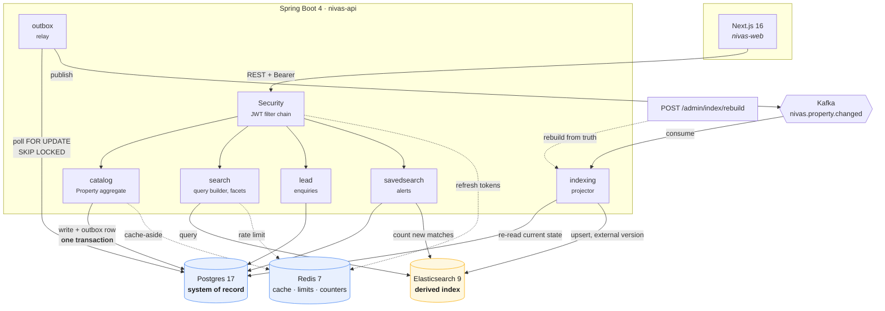
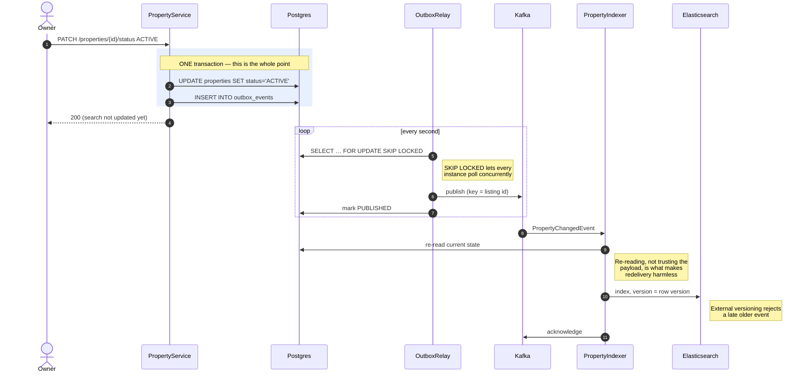
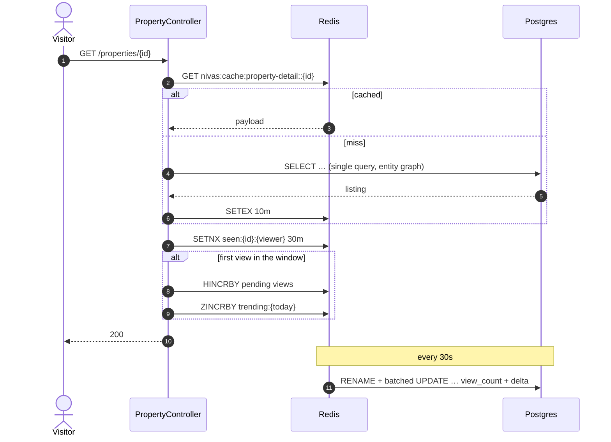

# Architecture

Postgres is the system of record. Elasticsearch serves search and is derived
from it — always rebuildable, never authoritative. Redis carries the state that
must be shared across instances but does not belong in a relational store.

## System overview

The dotted line from the admin endpoint is the safety net: because the index is
derived, it can be dropped and rebuilt from Postgres at any time. That is what
makes the whole pipeline recoverable rather than merely careful.

## The write path

Publishing a listing is the case everything else is designed around. The listing
and its event must commit together, or search silently diverges from the truth.

If the process dies between steps 3 and 4, the event is still in the outbox and
is retried. If it dies after publishing but before acknowledging, the event is
redelivered — and steps 8–9 make that a no-op rather than a corruption.

The cost is that search is *eventually* consistent: a listing is typically
searchable a second or two after publishing. For a property portal that is
invisible. For seat booking it would be unacceptable, and this would be the
wrong design.

## The read path

Counting a view as a relational write would put a row lock on the most popular
listings and turn the busiest read in the product into a write on the primary.
Accumulating in Redis and folding down in batches makes the counter approximate
— fine for a ranking signal, wrong for anything billed.

`RENAME` before reading matters: read-then-delete would drop every view recorded
between the two calls. The snapshot is only discarded once the counts are
durably in Postgres, and folded back on failure.

## Where each store earns its place

| Store | Holds | Why not elsewhere |
| --- | --- | --- |
| **Postgres** | Listings, users, leads, saved searches, outbox | Transactions, foreign keys, unique constraints. Lead idempotency and ownership would be application-level guesses anywhere else. |
| **Elasticsearch** | One flat document per ACTIVE listing | Faceted aggregations returned with every query, geo filters, analyzers. Postgres makes you hand-roll each facet as its own slow query. |
| **Redis** | Refresh tokens, cached payloads, rate-limit windows, view counters | Keyed lookups with natural expiry. `SETEX` gives cleanup for free; Postgres would need a table and a job. |
| **Kafka** | The change stream | Decouples the relay from the indexer and preserves per-listing ordering via partition key. |

## What is deliberately not here

- **No CQRS framework, no event sourcing.** The outbox gives the one guarantee
  that was actually needed. Event sourcing would mean rebuilding state from a
  log, which nothing here requires.
- **No microservices.** A modular monolith with clear package boundaries. The
  indexer could be extracted into its own deployable without touching its code —
  it already communicates only over Kafka — and that is the point.
- **No service mesh, no Kubernetes manifests.** They would demonstrate YAML, not
  engineering.
